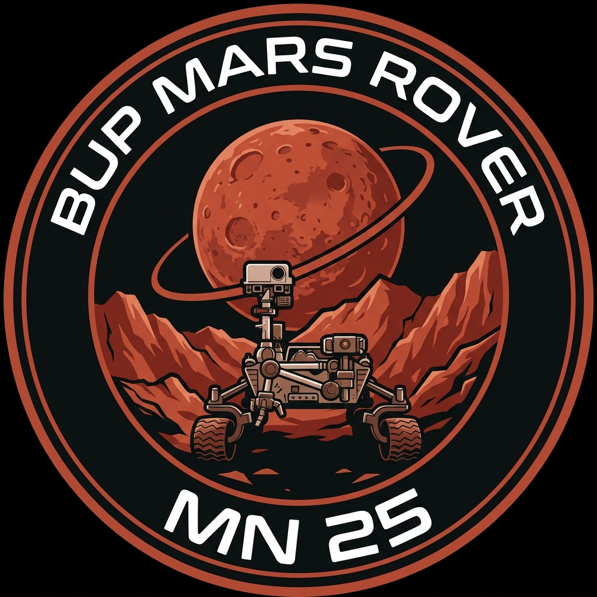

# 🔴 BUP Mars Rover Team — MN-25 Expedition

### **Bangladesh University of Professionals (BUP)**
**Next-Generation Planetary Exploration Rover & Autonomous Ground Station**

---

## 🌌 Executive Summary

The **BUP Mars Rover Team** (designated **Team MN-25 / Project Monpura**) is the premier university robotics initiative from the **Bangladesh University of Professionals (BUP)**. Engineered to compete in international competitions such as the **University Rover Challenge (URC)** and global analog astronaut challenges, our mission advances autonomous robotics, extreme terrain mobility, extraterrestrial life detection, and precision sample manipulation.

This repository houses the **official mission platform and operator ground-control telemetry interface**, presenting real-time system monitoring, 3D subsystem breakdowns, mission task profiles, and division documentation.

---

## 🎯 Mission Vision & Core Objectives
